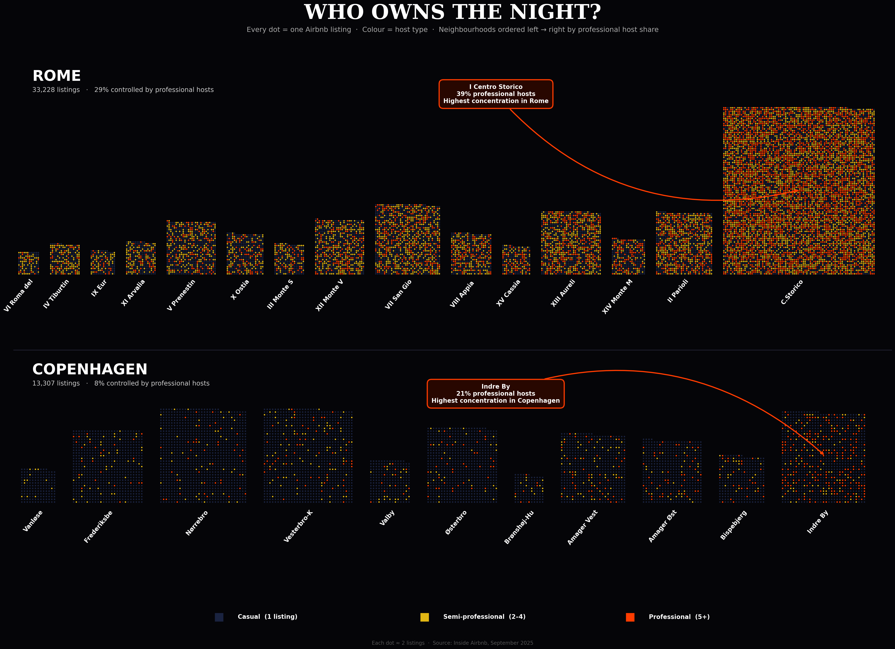
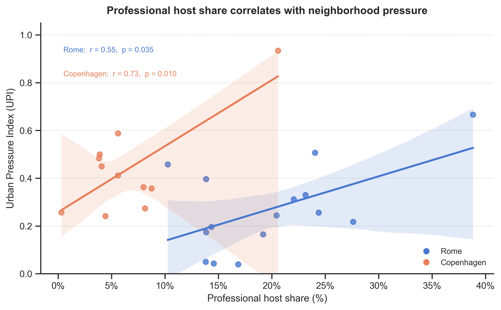
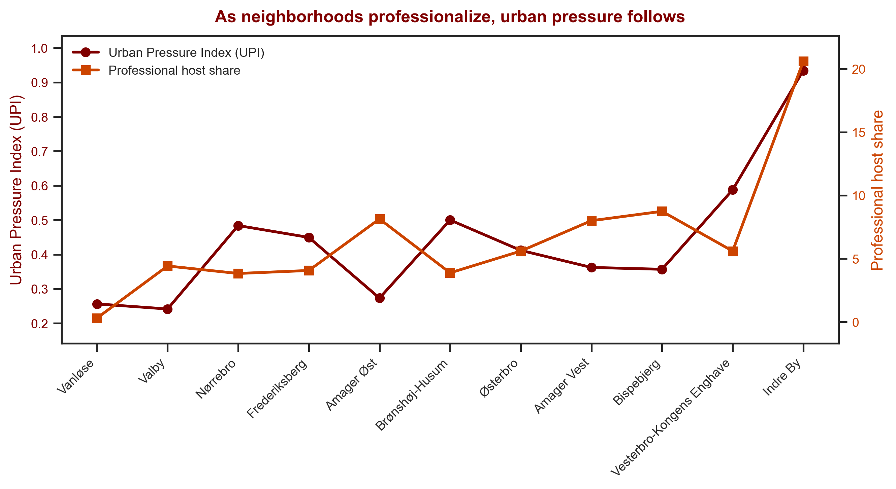

# Airbnb Market Structures: Rome vs Copenhagen

**Group project · Data Visualisation course · A.Y. 2025/2026 · LUISS**

Is the Airbnb market concentrated among professional hosts, and where does that concentration turn into urban pressure? A comparison of **46,535 listings** in Rome and Copenhagen (Inside Airbnb, September 2025), presented as an interactive website with Tableau dashboards.

**Website:** [romevscopenhagen.wpcomstaging.com](https://romevscopenhagen.wpcomstaging.com)



## Key findings

| | Rome | Copenhagen |
|---|---|---|
| Listings (after cleaning) | 33,228 | 13,307 |
| Listings run by professional hosts (5+ listings) | **29.4%** | 7.8% |
| Listings controlled by the top 10% of hosts | **39.2%** | 20.0% |
| Gini coefficient (listings per host) | **0.39** | 0.11 |
| Median availability | 260 days / year | 115 days / year |
| Median price per night | €132 | €161 |

- **Rome has become a commercial market:** professional hosts are only 5.1% of hosts but run 29.4% of listings; with semi-professional hosts, multi-listing operators control 58% of supply
- **Copenhagen is still largely peer-to-peer:** 96% of hosts have a single listing and casual hosts run 85% of listings
- **Pressure is local, not city-wide:** the Urban Pressure Index peaks in I Centro Storico (Rome) and Indre By (Copenhagen)
- Neighbourhoods with more professional hosts show higher pressure (Pearson r = 0.55 in Rome, 0.73 in Copenhagen, p < 0.05), a **correlation, not proof of causation**

## Approach

1. **Data cleaning:** price conversion (DKK → EUR), removal of listings without price and of prices above the 99th percentile, harmonised neighbourhood names
2. **Host classification:** casual (1 listing), semi-professional (2–4), professional (5+), counted within each city
3. **Concentration metrics:** Lorenz curve, Gini coefficient, top-1% / top-10% host dominance, HHI
4. **Urban Pressure Index (UPI):** per neighbourhood, `0.5 × listing count + 0.5 × availability`, each min-max normalised within the city. Price is left out because 41% of Copenhagen listings have no price; a version with price is computed as a robustness check
5. **Visualisation:** Tableau dashboards (maps, rankings, price vs pressure), an interactive city explorer in JavaScript and a creative "dot per listing" chart

## Honest vs misleading charts

The project includes a white-hat / black-hat exercise: the same data shown honestly and in a misleading way.

| White hat | Black hat |
|---|---|
|  |  |
| Both cities, axes from zero, 95% confidence intervals, r and p-values shown | Copenhagen only, neighbourhood order engineered and two rescaled y-axes to suggest causation |

## Tableau dashboards

- [Explanatory dashboard](https://public.tableau.com/views/Cartella2_17774709061460/ExplanatoryDashboard)
- [Neighbourhood ranking](https://public.tableau.com/views/Cartella2_17774709061460/NeighbourhoodRankingdashboard)
- [Professional host concentration](https://public.tableau.com/views/Cartella2_17774709061460/ProfessionalHostConcentrationRomevsCopenhagen)
- [UPI dashboard](https://public.tableau.com/views/Cartella2_17774709061460/UPIDashboard)
- [Price vs urban pressure](https://public.tableau.com/views/Cartella2_17774709061460/PricevsUrbanPressurebyNeighbourhooddash)

## Repository structure

```
├── airbnb_analysis.ipynb   # cleaning, host classification, metrics, UPI, charts
├── website/
│   ├── page.html           # page content (embedded in WordPress as a Custom HTML block)
│   ├── styles.css
│   └── script.js           # city explorer and white/black hat toggle
├── data/
│   └── export/
│       ├── neighbourhood_upi.csv   # neighbourhood aggregates and UPI scores
│       └── *.png                   # charts used on the website
├── pyproject.toml / uv.lock
└── README.md
```

## How to run

1. Get the **September 2025** detailed `listings.csv.gz` and `neighbourhoods.geojson` for Rome and Copenhagen from [Inside Airbnb](https://insideairbnb.com/get-the-data/) (snapshots older than 12 months are available through an archived data request). The raw files are not included here: Inside Airbnb asks users not to republish its data, and the files contain host-level information
2. Save them as:
   ```
   data/rome/listings_Rome.csv
   data/rome/neighbourhoods_Rome.geojson
   data/copenhagen/listings_Copenhagen.csv
   data/copenhagen/neighbourhoods_Copenhagen.geojson
   ```
3. Install the dependencies and run the notebook top to bottom:
   ```bash
   pip install uv
   uv sync
   uv run jupyter notebook airbnb_analysis.ipynb
   ```
   The notebook writes all outputs to `data/export/`, including the listing- and host-level files (`listings_clean.csv`, `host_stats.csv`) and the combined boundaries (`neighbourhoods_combined.geojson`) used by the Tableau dashboards

## Tech stack

Python (pandas, GeoPandas, scikit-learn, SciPy, Matplotlib, seaborn) · Tableau Public · HTML / CSS / JavaScript · WordPress

## Limitations

- 41% of Copenhagen listings have no price, so dropping them may introduce selection bias
- A single snapshot (September 2025): seasonal patterns are not captured
- The UPI measures Airbnb activity intensity, not housing displacement; neighbourhood area and population are not included
- Only listings published on Airbnb are covered

## Data source

Data from [Inside Airbnb](https://insideairbnb.com), September 2025 snapshots for Rome and Copenhagen.
